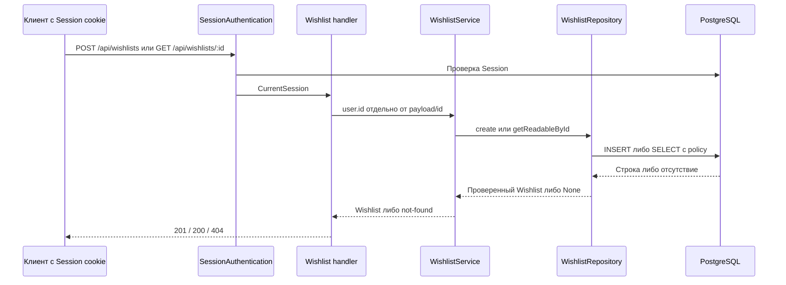

# Design

## Context

Мотивация, объём и расхождения находятся в [proposal.md](proposal.md). Поведение задаёт [delta-spec wishlists](specs/wishlists/spec.md).

Рабочие образцы: `modules/users` для repository/service/handlers; `modules/auth` для `SessionAuthentication` и `CurrentSession`. `modules/account` пока содержит учебные заготовки.

Текущая инфраструктура использует `DBLive` поверх PgClient и SQL/Kysely, camelCase на TypeScript-границе и snake_case в PostgreSQL. Миграции выполняются через PgMigrator. Тесты поднимают PostgreSQL 16.3 через Testcontainers.

Установленный `@effect/sql-pg` версии `4.0.0-rc.108` поддерживает `PgClientConfig.types` и передаёт его пулу и отдельному соединению. Установленный kysely-codegen `0.20.0` поддерживает `dateParser: "string"`. Новая зависимость не нужна.

## Goals / Non-Goals

**Goals:**

- Оставить владельца отдельным аргументом use case, а не частью клиентского payload.
- Совместить проверку доступа и получение Wishlist в одном SELECT.
- Разделить нормализацию входа, проверку сохранённой строки и JSON-представление.
- Использовать существующие зависимости, ошибки и Layer без второй инфраструктуры auth или SQL.

**Non-Goals:**

- Не создавать общий CRUD-фреймворк или универсальный policy engine.
- Не проектировать будущие таблицы Items, Reservations и Sharing Links.
- Не менять принятый порядок работ и поля Milestone 2; не объявлять существующий CRUD Users безопасным.

## Decisions

### 1. Схемы входа, записи и ответа имеют разные задачи

Предлагаемые файлы: `modules/wishlists/schemas/wishlist.schema.ts`, `create-wishlist.schema.ts`, `wishlist-response.schema.ts`, `wishlist-operations.schema.ts`.

- `WishlistIdSchema` использует существующий `makeIdBrandedSchema`; `ownerId` использует `UserIdSchema`.
- Входной `title` использует trim перед проверкой длины. Входной `description` удаляет крайние пробелы и преобразует пустую строку в `null`.
- Отсутствующие nullable поля получают `null`; `visibility` получает значение по умолчанию только при отсутствии.
- `occasionDate` проверяется чистым календарным предикатом: точный формат, диапазон года 0001–9999, месяц, число дней и високосность.
- Строка с временем или с невозможной датой не проходит проверку. `Date.parse` не используется: он может нормализовать невозможную дату.
- Schema сохранённой строки проверяет данные без trim, defaults и исправления повреждённой записи. `title: " "` не проходит проверку непустого после trim значения; строка не нормализуется. Timestamps остаются `Date` внутри persistence.
- Schema сохранённой строки и read проверяют календарный формат Occasion Date, но не окно относительно текущего времени.
- Response Schema кодирует timestamps строками ISO 8601; Occasion Date остаётся строкой или `null`.
- Входной Struct получает `withRequestParseOptions`; серверные и произвольные поля отклоняются.

Длина следует существующим `Schema.isMinLength`/`isMaxLength`, без введения подсчёта графем. Тесты используют простые символы на границах.

Альтернатива — одна схема для всего — отклонена. Нормализация строки из БД скрывает повреждение; входной контракт не содержит серверных полей.

#### Окно входной Occasion Date

Первым тестом задачи 1.1 проверить `SchemaGetter.checkEffect` с `Clock` именно через декодирование payload HttpApi. Успех прямого `Schema.decodeUnknownEffect` этого не доказывает.

Один HTTP-тест принимает вчера по управляемым часам, затем после перевода этих часов отклоняет ту же дату как позавчера. Часы предоставляются runtime запроса, а не только внешнему Effect теста. Не использовать реальные часы и не кэшировать результат проверки.

При подтверждённом основном пути входная Schema читает `Clock` при каждом decode и выполняет проверку через `SchemaGetter.checkEffect`. Валидация формата предшествует окну; `null` и отсутствие даты не проверяются по времени. Отказ идёт через существующий middleware валидации: 400 `REQUEST_VALIDATION_FAILED`.

Проверку окна привязать к полю `occasionDate`, не к корню Struct. В ответе `errors` содержит ровно одну запись с `location: "payload"`, `path: ["occasionDate"]` и `message`, содержащим обе допустимые границы текущего UTC-окна.

Из текущего времени Clock получить календарную дату UTC, а не локальную дату процесса. Нижняя граница — предыдущий день. Верхняя — та же календарная дата через пять лет; 29 февраля ограничивается последним днём февраля целевого года. Обе границы включены; это не интервал `5 * 365` дней.

`TestClock` фиксирует `2026-10-12T12:00:00Z`: `2026-10-10` отклоняется, `2026-10-11` принимается, `2031-10-12` принимается, `2031-10-13` отклоняется. При тестировании високосности отдельно проверять чистую календарную Schema, чтобы окно не скрывало причину отказа.

Если HTTP-тест показывает, что HttpApi не выполняет `checkEffect` с Clock, выбрать запасной путь из Milestone 2. Формат остаётся во входной Schema; service проверяет окно через Clock и выдаёт `WishlistOccasionDateOutOfRangeError`. Handler кодирует её как 400 problem+json с предлагаемым кодом `WISHLIST_OCCASION_DATE_OUT_OF_RANGE` и путём create в `instance`.

При запасном пути удалить неработающую эффектную проверку из payload Schema и объявить собственный 400 в HttpApi. Не оставлять две проверки окна. При основном пути прямой create service окно не проверяет: сейчас его единственный вход — HTTP. При появлении второго входа правило переносится в service по решению плана.

После выбора пути в задаче 1.1 обновить delta-spec: оставить только выбранный код 400 в требовании окна и обоих сценариях отказа. Удалить проигравшую ветку кода ошибки; детализация `errors` остаётся обязательной для выбранного основного пути.

Read и Schema сохранённой строки не получают Clock и не проверяют окно. Wishlist со старой Occasion Date остаётся читаемым; PostgreSQL не получает CHECK с `now()`. Обновление самой даты относится к будущему update, не к этому change.

### 2. Миграция добавляет только текущий aggregate

Предлагаемая миграция: `infra/db/migrations/0004_wishlists.ts`. Старые миграции не изменяются.

| Поле PostgreSQL | Определение                                                                                      |
| --------------- | ------------------------------------------------------------------------------------------------ |
| `id`            | `UUID PRIMARY KEY DEFAULT gen_random_uuid()`                                                     |
| `owner_id`      | `UUID NOT NULL REFERENCES users(id) ON DELETE CASCADE`                                           |
| `title`         | `varchar(255) NOT NULL`, `CONSTRAINT wishlists_title_not_blank_check CHECK (btrim(title) <> '')` |
| `description`   | `varchar(1000) NULL`, `CHECK (description IS NULL OR btrim(description) <> '')`                  |
| `occasion_date` | `date NULL`                                                                                      |
| `visibility`    | ENUM `wishlist_visibility` (`private`, `public`), `NOT NULL DEFAULT 'private'`                   |
| `created_at`    | `timestamp(3) with time zone NOT NULL DEFAULT now()`                                             |
| `updated_at`    | `timestamp(3) with time zone NOT NULL DEFAULT now()`                                             |

Названия таблицы `wishlists`, ENUM и ограничений новые, предложенные этим change. Создать неуникальный `wishlists_owner_id_idx` для связи с владельцем. PK обслуживает read по id; индекс Public discovery и сортировки list здесь не нужен.

`ON DELETE CASCADE` следует существующим зависимым таблицам Session и Password Credential. FK запрещает осиротевший Wishlist; индекс FK сам PostgreSQL не создаёт. Это не реализация DELETE Wishlist.

Альтернативы: `RESTRICT` меняет существующее удаление User; уникальный `owner_id` запрещает несколько Wishlist; индекс пагинации преждевременен для двух use case.

Проверка varchar и CHECK не заменяет входной trim. Прямой SQL не нормализует поля автоматически. Точность существующей календарной даты обеспечивает PostgreSQL `date`; формат и текущее окно create проверяются на входе. CHECK с `now()` не добавляется.

### 3. Настройка date parser общая для live и test

Создать небольшой `infra/db/pg-types.ts` с единственным объектом `types` для пула.

Его `getTypeParser` возвращает OID 1082 в текстовом формате без изменений. Для остальных OID и форматов он делегирует стандартному parser `pg.types.getTypeParser`. Тип выводится из установленных типов `pg`, без `any` или небезопасных assertions.

Оба существующих `PgClient.layer` — `config.ts` и `test-database.layer.ts` — получают этот объект. Глобальный `pg.types.setTypeParser` не используется. `.kysely-codegenrc.json` получает `dateParser: "string"`.

Альтернатива — превращать `Date` обратно в строку в каждом repository — отклонена принятым решением Milestone 2. Она также может сдвинуть дату при смене TZ.

Проверка: одна и та же запись `2028-02-29` читается как string в отдельных процессах `UTC`, `Europe/Moscow`, `America/Los_Angeles`. HTTP smoke дополнительно использует живое подключение, а не только test Layer.

### 4. Use case принимает actor отдельно от payload

Предлагаемые интерфейсы:

- `WishlistService.create(ownerId: UserId, input: CreateWishlistBody)` возвращает сохранённый Wishlist.
- `WishlistService.getById(viewerId: UserId, id: WishlistId)` возвращает доступный Wishlist либо `WishlistNotFoundError`.
- Repository `create(ownerId, input)` делает один INSERT с четырьмя нормализованными полями и владельцем; RETURNING возвращает восемь полей контракта.
- Repository `getReadableById(viewerId, id)` возвращает `Option<Wishlist>` и использует предикат ниже.

```sql
WHERE id = :wishlistId
  AND (owner_id = :viewerId OR visibility = 'public')
```

Service переводит `None` в один `WishlistNotFoundError({ id })`, где `id` взят из запроса. Отдельной предварительной ownership query нет. Handler берёт actor исключительно из `CurrentSession.user.id`; query `ownerId` ничего не выбирает.

Будущие Items/Reservations используют этот use case чтения, а не копируют visibility predicate. Сейчас отдельный policy-модуль не создаётся: у правила один потребитель и один SQL-предикат.

Альтернатива — загружать любую строку и проверять доступ только в handler — отклонена: прямой вызов service обойдёт защиту.



### 5. Новые HTTP-контракты следуют работающим группам

Предлагаемые constants: `wishlistsCollectionPath = '/api/wishlists'`, `wishlistByIdPath = '/api/wishlists/:id'`, `wishlistsGroupIdentifier = 'wishlists'`.

Создать одну HttpApiGroup с `SessionAuthentication`; операции — `create` и `getById`. Create response получает статус 201, read response — 200. Объявить `technicalHttpErrors` и доменный not-found через `domainProblem`.

Новый `WISHLIST_NOT_FOUND` — предлагаемое имя, которого пока нет в коде. Тело строится через существующий `makeNotFoundBody` по образцу Users: `code`, `detail`, `status`, `title: "Wishlist not found"`, `type`, запрошенный `id`, `instance`.

Создать `WishlistByIdInstanceSchema` и локальный `makeByIdInstance(id)` по образцу `users.api.errors.ts`: `${wishlistsCollectionPath}/${id}`. `domainProblem` кодирует `WishlistNotFoundError({ id })`; `instance` строится из id ошибки, а не из URL или строки БД.

404 не раскрывает владельца, title данных или visibility. Запрошенный id не является извлечённым полем скрытой строки. Для одного и того же id тело скрытого и отсутствующего Wishlist совпадает полностью, включая `id` и `instance`.

`WishlistModuleLive` соединяет service и repository по образцу Users. Entry point предоставляет существующий DB. Группа и handlers добавляются в `api.ts` и `api-live.ts`; module — в `app.ts`.

Альтернатива — отдельный HTTP server или сборка AuthModule внутри Wishlist — отклонена: она дублирует существующие зависимости.

### 6. Общий 401 получает путь запроса на HTTP-границе

`AuthUnauthenticatedError` остаётся доменной ошибкой без HTTP-полей. Service ничего не знает о URL.

На HTTP-границе заменить закреплённую за `/api/auth/me` схему на `AuthUnauthenticatedHttpError` с `instance: Schema.String`. `SessionAuthenticationLive` ловит доменный отказ и формирует транспортную ошибку с `getRequestPathname(request)`.

Заменить объявление ошибки в `SessionAuthentication`, мигрировать все реальные потребители старой схемы и удалить её. Перед изменением экспортов проверить references через LSP. Для `/api/auth/me` тело 401 остаётся прежним; новых алиасов и совместимых обёрток нет.

Альтернатива — добавить URL в доменный класс или hardcode Wishlist в auth — отклонена: HTTP зависит от конкретного запроса, не от service.

Технические отказы уже берут `instance` из запроса через `makeTechnicalFailureHandler`. Ошибки Wishlist следуют [ADR-0005](../../../docs/adr/0005-technical-failure-logging-and-5xx-contract.md): repository создаёт `OperationFailed`, service пропускает его, handler переводит в 500/503.

Контекст операции `AuthOperation.me` в существующем auth middleware отмечен в proposal. Его переименование не является условием нового контракта: auth-сбой до handler остаётся auth-сбоем, а его `instance` уже указывает фактический запрос.

Не добавлять 409 без реального конфликтного ограничения. У нескольких Wishlist одного владельца и одинаковых title нет конфликта.

### 7. Проверки отражают реальные границы

- Шаг 3.1: сначала доказательство выполнения `checkEffect` с Clock в HttpApi, затем таблица Schema и четыре UTC-границы под TestClock. Формат проверять отдельно от временного окна.
- Шаг 3.2: миграция на схеме после `0003` с существующими User; прямые SQL-вставки, defaults, FK, несколько Wishlist, каскад с изоляцией другого владельца.
- Date-only: тот же PostgreSQL repository round-trip в отдельных TZ-процессах. Проверять значение и runtime string, а не только generated type.
- Шаг 3.3: HTTP-тесты через существующий `HttpRouter.toWebHandler` и PostgreSQL; конечная матрица owner/other/anonymous, видимость, id и Problem Details.
- Прямые вызовы service проверяют owner/other без HTTP: защита не зависит от handler.
- 503 и внутренний SQL-отказ проверяются контролируемыми отказами по образцу auth. Для «Повреждённая строка при read» использовать отдельную тестовую БД: снять `wishlists_title_not_blank_check`, вставить доступный Wishlist с `title: " "`, проверить GET → 500. После теста удалить повреждённую строку и восстановить CHECK в cleanup даже при отказе; рабочая БД не затрагивается.
- Для чтения старой даты напрямую вставить SQL-фикстуру W с `occasionDate: "2020-02-29"` и выполнить GET с действующей Session. TestClock остаётся на `2026-10-12T12:00:00Z`: сдвиг на шесть лет истечёт Session и проверит 401 вместо чтения.
- Smoke: собранный Node server, signup A/B, create Private/Public, read обоими User, anonymous и неверная Session.

Для фиксированной матрицы предпочтительны table-driven тесты; FastCheck не нужен для повторной проверки библиотечных ENUM и длины.

Во время apply наставничество остаётся активным. По `learning/STATE.md` шаг 3.1 начинается катой: агент пишет поведенческие тесты, владелец — Schema. Это меняет формат работы, но не критерии завершения.

## Risks / Trade-offs

- Открытый CRUD Users позволяет удалить владельца и каскадно его Wishlist → явно сохранить этот риск; роли остаются отложенными по решению владельца.
- Public Wishlist пока требует Session → проверить 401 анонима даже для `public`; не подключать Sharing и Public Profile заранее.
- Некорректный parser остальных OID ломает timestamps или другие значения → делегировать стандартному parser, проверить существующие тесты после изменения.
- `btrim` PostgreSQL и trim JavaScript не совпадают для всех Unicode whitespace → не обещать одинаковую нормализацию; сохранить точные CHECK из таблицы Milestone 2.
- User исчезает между аутентификацией и INSERT → FK отклоняет запись; не выдавать ложный 201 и не добавлять отдельную транзакцию ради снимка Session.
- Отказ декодирования после успешного INSERT может дать 500 при уже сохранённой строке → не обещать rollback для любого 5xx и не добавлять повтор INSERT.
- Успех unit-тестов не доказывает настройку live PgClient → запускать настоящий server/PostgreSQL smoke.
- Прямой decode может подтвердить checkEffect, а HttpApi — пропустить его → первый HTTP-тест выбирает основной или запасной путь до реализации остального контракта.

## Migration Plan

1. На изолированной тестовой БД проверить переход `0001`–`0003` → `0004`, не меняя старые миграции и записи User.
2. Перед применением миграции к локальной пользовательской БД получить подтверждение владельца. Миграция идёт вперёд, пересоздавать БД не требуется. Решение владельца разрешает пересоздать локальную БД; это не обязательный шаг миграции.
3. Выполнить `pnpm --filter @wishlist/api db:migrate`, затем `db:generate` и `db:check` с новым `dateParser`.
4. Собрать приложение и выполнить smoke двумя User. Тестовые данные создаются уникальными и удаляются адресно после проверки.
5. После smoke обновить существующие документы и `learning/reference/system-map.html`; не отмечать шаг выполненным без его проверок.

Обратной миграции нет: действует решение владельца из `learning/STATE.md`. Откат приложения оставляет добавленную таблицу; исправление схемы выполняется следующей миграцией вперёд. Удаление пользовательских данных не является автоматическим rollback.
